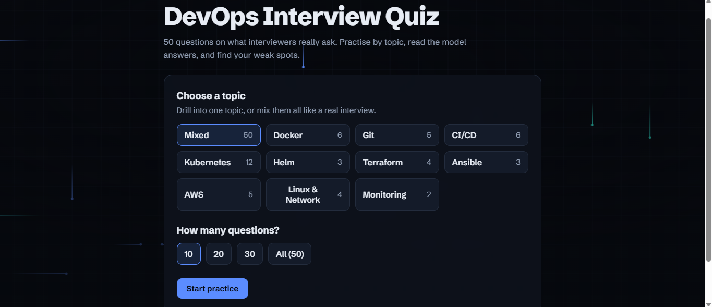
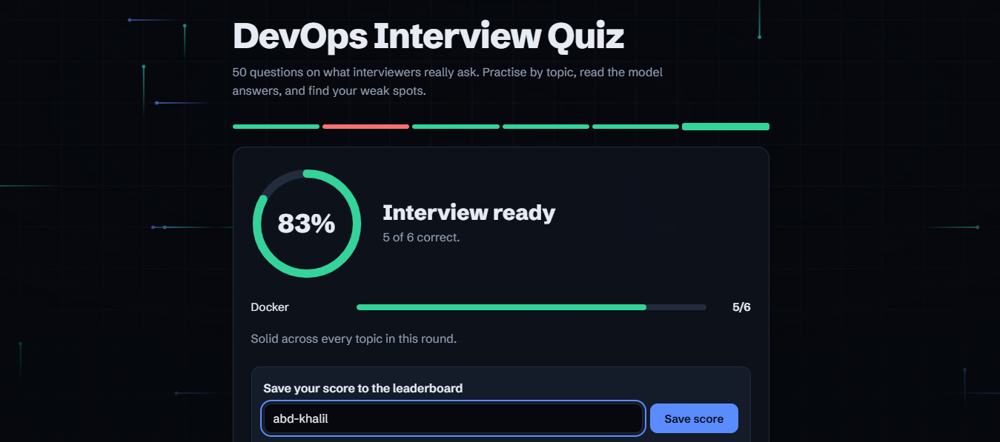
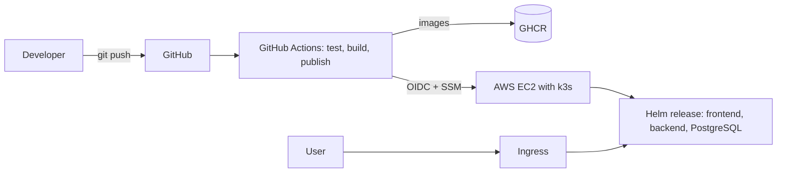
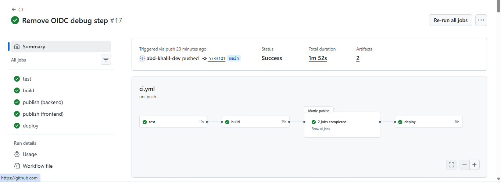

# DevOps Interview Quiz


A 3-tier quiz app with 50 DevOps interview questions, built as a hands-on project to practise
the whole DevOps toolchain: containers, CI/CD, Kubernetes, Helm, Terraform, Ansible and AWS.





## What it shows

- **Docker and Compose**: multi-container app behind an nginx reverse proxy
- **CI/CD (GitHub Actions)**: tests, Helm lint, image build, smoke test, publish to GHCR, deploy to AWS
- **Kubernetes**: Deployments, a StatefulSet with a PVC for PostgreSQL, Secrets, probes, Ingress
- **Helm**: one chart for the whole app, configured with `values.yaml`
- **Terraform**: Security Group, EC2, key pair, IAM roles, GitHub OIDC provider, CloudWatch alarms and dashboard, SNS alerts
- **Ansible**: configures the server (k3s and Helm), idempotent
- **Security**: no keys in GitHub (OIDC), no open admin port (AWS SSM), Secrets kept out of Git
- **Monitoring**: CloudWatch alarms (CPU, instance status checks) with SNS email alerts and a dashboard, all defined in Terraform

## Architecture



| Layer | Tech |
|---|---|
| Frontend | HTML, CSS, JavaScript served by nginx (also the reverse proxy for `/api`) |
| Backend | Python, Flask, gunicorn |
| Database | PostgreSQL 16 (StatefulSet and PVC on Kubernetes) |
| Delivery | GitHub Actions, GHCR, Helm |
| Infrastructure | Terraform (AWS), Ansible, k3s |



## Run it locally (Docker Compose)

```bash
docker compose up --build
```
Open http://localhost:8080

## Run it on Kubernetes (minikube)

```bash
kubectl create namespace quiz
kubectl create secret generic db-secret -n quiz --from-literal=POSTGRES_PASSWORD='choose-a-password'
helm install quiz ./helm/quiz -n quiz
kubectl port-forward svc/frontend 8081:80 -n quiz
```

## Deploy to AWS

Needs an AWS account, the AWS CLI configured, Terraform and Ansible.

```bash
scripts/up.sh      # server, k3s, Helm, quiz (about 10 minutes)
scripts/down.sh    # destroys everything, stops the bill
```
Optional: put `alert_email = "you@example.com"` in `terraform/terraform.tfvars` to get CloudWatch alarm emails (confirm the SNS subscription once).

After the first run, every push to `main` deploys by itself (OIDC and SSM).

## How the pipeline works

1. **test**: pytest and `helm lint`
2. **build**: builds both images, starts the stack and smoke-tests it through nginx
3. **publish**: pushes images to GHCR tagged with the commit SHA
4. **deploy**: assumes an AWS role through OIDC, then runs `helm upgrade --atomic` on the server with SSM. A failed release rolls back by itself. The deploy job needs the stack to be up (`scripts/up.sh`), because `scripts/down.sh` also destroys the AWS role it assumes

## API

| Method | Path | What it does |
|---|---|---|
| GET | /api/health | Liveness check |
| GET | /api/ready | Readiness check (database reachable) |
| GET | /api/info | Pod name and app version |
| GET | /api/categories | Topics and question counts |
| GET | /api/questions | Random questions (`category`, `count`) |
| POST | /api/answer | Checks an answer and returns the explanation |
| POST | /api/scores | Saves a score |
| GET | /api/leaderboard | Top scores |

## Design decisions

- **OIDC instead of stored AWS keys**: GitHub gets short-lived credentials, and the role only trusts this repo's `main` branch.
- **SSM instead of SSH from CI**: the server never needs port 22 open to the internet.
- **Image tags use the commit SHA**: every deploy is traceable, and rollback is a `helm rollback`.
- **Atomic releases**: `helm upgrade --atomic` rolls back automatically if the new version never becomes ready.
- **Readiness and liveness are separate**: a database outage removes pods from traffic, but does not restart them.
- **Secrets are created with `kubectl`**, never committed.

## Known limitations

- Scores are sent by the browser, so a user could fake one. A real system would track answers on the server.
- HTTP only for now. HTTPS needs a real domain (cert-manager and Let's Encrypt).
- Single node, and service names are fixed, so one release per namespace.
- Monitoring covers the EC2 host only (CPU, network, status checks), not app-level metrics.

## Roadmap

- [x] Flask backend and quiz frontend
- [x] Docker, Compose and nginx reverse proxy
- [x] CI with GitHub Actions
- [x] Images published to GHCR
- [x] PostgreSQL leaderboard
- [x] Kubernetes manifests and Helm chart
- [x] Ingress
- [x] Terraform and Ansible on AWS
- [x] CD: automatic deploy on every push
- [x] Monitoring with CloudWatch alarms, SNS alerts and a dashboard
- [ ] In-cluster metrics with Prometheus and Grafana
- [ ] HTTPS with a domain

Built by [abd-khalil-dev](https://github.com/abd-khalil-dev).
