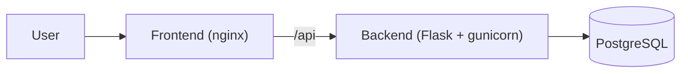

# DevOps Interview Quiz


A 3-tier web app with 50 DevOps interview questions, built to practise real DevOps work:
containers, CI/CD, Kubernetes, Helm, Terraform, Ansible and AWS.


## Architecture



## Run it locally

```bash
docker compose up --build
```
Open http://localhost:8080

## API

| Method | Path | What it does |
|---|---|---|
| GET | /api/health | Health check |
| GET | /api/info | Pod name and app version |
| GET | /api/categories | Topics and question counts |
| GET | /api/questions | Random questions (`category`, `count`) |
| POST | /api/answer | Checks an answer and returns the explanation |
| GET | /api/ready | Checks that the database is reachable |
| POST | /api/scores | Saves a score (name, topic, correct, total) |
| GET | /api/leaderboard | Top scores |
## Roadmap

- [x] Flask backend and quiz frontend
- [x] Docker, Docker Compose and nginx reverse proxy
- [x] CI with GitHub Actions (tests, build, smoke test)
- [x] Push images to a registry
- [x] PostgreSQL with a leaderboard (StatefulSet on Kubernetes comes next)
- [x] Kubernetes manifests and a Helm chart
- [ ] Terraform (VPC, EC2) and Ansible on AWS
- [ ] CD: automatic deploy on every push
- [ ] Monitoring with Prometheus and Grafana
“Built as a DevOps learning project.”
